# Student Marks Management API

A layered ASP.NET Core minimal API for managing students, courses, enrollments, marks, course statistics, and student transcripts. The API uses JWT bearer authentication, role-based authorization, EF Core migrations, and PostgreSQL.

This repository contains the Phase 8 completion of the project: statistics, weighted transcripts, standardized errors, health checks, security hardening, a Postman collection, automated smoke tests, a schema export, and documentation.

## Features

- JWT login with `Teacher` and `Student` roles.
- Student CRUD with pagination, search, and safe sorting.
- Course CRUD with unique codes and credit-hour validation.
- Enrollment management with optional (nullable) marks.
- Duplicate enrollment prevention at the application and database levels.
- Course statistics: enrolled/graded/ungraded counts, average, highest, and lowest marks.
- Transcripts with a credit-hour weighted average and a configurable pass mark.
- Student ownership checks: students can read only their own record and transcript.
- Standardized `ProblemDetails` responses for validation, authentication, authorization, not-found, conflict, and server errors.
- Global exception handling that logs the exception but never returns stack traces or database details.
- `GET /health` with application and PostgreSQL connectivity checks.
- Restricted CORS configured from `appsettings.json`.
- Postman collection with 49 requests and 105 assertions.
- Explicit smoke-test mode using real HTTP requests and the real database.
- `db/schema.sql` exported with `pg_dump --schema-only`.

## Technologies

| Component | Version / choice |
|---|---|
| Runtime | .NET 10 (`net10.0`) |
| Web framework | ASP.NET Core minimal APIs |
| ORM | EF Core 10 with `EFCore.NamingConventions` (snake_case) |
| Database | PostgreSQL 18 |
| Authentication | `Microsoft.AspNetCore.Authentication.JwtBearer` |
| Password hashing | `Microsoft.AspNetCore.Identity.PasswordHasher<T>` |
| Health checks | `Microsoft.Extensions.Diagnostics.HealthChecks.EntityFrameworkCore` |
| API testing | Postman / Newman 6.2.3 |
| Smoke tests | Custom `HttpClient` runner in `SmokeTests/` |

## Architecture

```text
Minimal API endpoints
        |
        v
Service interfaces
        |
        v
Service implementations
        |
        v
AppDbContext (EF Core)
        |
        v
PostgreSQL
```

```text
src/marks_api/
├── Common/                  ServiceResult and PagedResult
├── Data/
│   ├── Configurations/      EF Core table/constraint configuration
│   ├── Entities/            Student, Course, Enrollment, User
│   ├── AppDbContext.cs
│   └── DbSeeder.cs
├── Dtos/                    Auth, Students, Courses, Enrollments
├── Endpoints/               Student, Course, Enrollment routes
├── Extensions/              ProblemDetails, result mapping, claims
├── Migrations/             InitialCreate
├── Services/
│   ├── Interfaces/
│   └── Implementations/
├── SmokeTests/              SmokeTestRunner, Client, Data, Results
├── Program.cs
└── appsettings.json
```

## Database design

The schema has four application tables:

| Table | Key columns | Constraints |
|---|---|---|
| `students` | `id`, `registration_no`, `full_name`, `email`, `created_at_utc` | PK `id`; unique `registration_no`; unique `email`; lowercase-email check |
| `courses` | `id`, `code`, `title`, `credit_hours`, `created_at_utc` | PK `id`; unique `code`; check `credit_hours BETWEEN 1 AND 4` |
| `enrollments` | `id`, `student_id`, `course_id`, `mark`, `enrolled_at_utc` | PK `id`; FKs to students/courses (`ON DELETE RESTRICT`); unique `(student_id, course_id)`; check `mark IS NULL OR mark BETWEEN 0 AND 100` |
| `users` | `id`, `username`, `password_hash`, `role`, `student_id` | PK `id`; unique `username`; FK to students (`ON DELETE RESTRICT`); check `role IN ('Teacher','Student')` |

`db/schema.sql` is a real `pg_dump --schema-only` export of the migrated database. It also contains EF Core's `__EFMigrationsHistory` table. No ERD is included; it is intentionally left for separate creation.

## Prerequisites

- .NET 10 SDK
- PostgreSQL 18 (or a compatible PostgreSQL version)
- `dotnet-ef` tool (10.x recommended)
- Optional: Postman desktop or Newman for the collection
- Optional: `psql` and `pg_dump` for schema inspection/export

## Setup

### 1. Restore and build

```bash
dotnet restore
dotnet build
```

### 2. Create the database

As a PostgreSQL administrator:

```sql
CREATE ROLE marks_user LOGIN PASSWORD '<choose-a-local-password>';
CREATE DATABASE marks_db OWNER marks_user;
```

### 3. Configure User Secrets

Run these commands inside `src/marks_api` (the project already has a `UserSecretsId`):

```bash
cd src/marks_api

dotnet user-secrets set "ConnectionStrings:Database" \
  "Host=localhost;Port=5432;Database=marks_db;Username=marks_user;Password=<local-password>"

dotnet user-secrets set "JwtSettings:SecretKey" "<at-least-32-bytes-random-secret>"
```

`appsettings.json` intentionally contains **no** connection string and **no** JWT secret. See `appsettings.Example.json` at the repository root for the full configuration shape. Never commit real values.

For the smoke tests, also set:

```bash
dotnet user-secrets set "SmokeTest:TeacherPassword" "Teacher@123"
dotnet user-secrets set "SmokeTest:StudentPassword" "Student@123"
```

The usernames default to `teacher1` and `ali.hassan`; override them with `SmokeTest:TeacherUsername` and `SmokeTest:StudentUsername` if needed.

### 4. Apply migrations

```bash
cd ../..
dotnet ef database update --project src/marks_api
```

There is one migration: `20261109132945_InitialCreate`. `db/schema.sql` is generated from the migrated schema and is not a replacement for the EF migration.

### 5. Run the API

```bash
dotnet run --project src/marks_api --launch-profile http
```

The HTTP profile listens on `http://localhost:5268`. The HTTPS profile also exposes `https://localhost:7151`. In Development, the seeder inserts the demo students, courses, enrollments, and users only when the tables are empty.

## Configuration

| Key | Purpose | Default |
|---|---|---|
| `ConnectionStrings:Database` | PostgreSQL connection (User Secrets) | none |
| `JwtSettings:SecretKey` | JWT signing key, at least 32 bytes (User Secrets) | none |
| `JwtSettings:Issuer` | JWT issuer | `marks_api` |
| `JwtSettings:Audience` | JWT audience | `marks_api_clients` |
| `JwtSettings:ExpirationMinutes` | Token lifetime | `60` |
| `TranscriptSettings:PassMark` | Transcript pass threshold | `50` |
| `Cors:AllowedOrigins` | Allowed browser origins | localhost dev origins |
| `SmokeTest:*` | Smoke-test credentials (User Secrets) | none |

The pass mark is read from configuration at runtime; it is not hard-coded in the transcript response.

## API endpoints

`Auth` is anonymous. `Teacher` and `Student` mean the endpoint requires a valid token with that role. "Own" means a Student may access only the student record linked to their token; a Teacher may access any student.

| Method | Route | Access | Purpose |
|---|---|---|---|
| POST | `/api/auth/login` | Anonymous | Return a JWT |
| GET | `/api/auth/me` | Any authenticated | Return current claims |
| GET | `/health` | Anonymous | Application + PostgreSQL health |
| GET | `/api/students` | Teacher | Paged, searchable, sortable list |
| GET | `/api/students/{id}` | Teacher, own Student | Student details |
| GET | `/api/students/{id}/transcript` | Teacher, own Student | Transcript |
| POST | `/api/students` | Teacher | Create student |
| PUT | `/api/students/{id}` | Teacher | Update student |
| DELETE | `/api/students/{id}` | Teacher | Delete student |
| GET | `/api/courses` | Teacher, Student | List courses |
| GET | `/api/courses/{id}` | Teacher, Student | Course details |
| GET | `/api/courses/{id}/stats` | Teacher, Student | Course statistics |
| POST | `/api/courses` | Teacher | Create course |
| PUT | `/api/courses/{id}` | Teacher | Update course |
| DELETE | `/api/courses/{id}` | Teacher | Delete course (409 when enrolled) |
| GET | `/api/courses/{courseId}/enrollments` | Teacher | Course enrollment list |
| POST | `/api/courses/{courseId}/enrollments` | Teacher | Enroll a student |
| PUT | `/api/enrollments/{id}/mark` | Teacher | Set/clear a mark |
| DELETE | `/api/enrollments/{id}` | Teacher | Remove an enrollment |

Student list query parameters: `page` (default 1), `pageSize` (default 10, maximum 100), `search`, `sortBy` (`id`, `fullName`, `registrationNo`, `email`, `createdAtUtc`), and `sortOrder` (`asc`/`desc`).

### Example responses

Course statistics (`GET /api/courses/1/stats`):

```json
{
  "courseId": 1,
  "courseCode": "CS-301",
  "courseTitle": "Advanced Programming",
  "totalEnrolled": 2,
  "gradedCount": 2,
  "ungradedCount": 0,
  "averageMark": 91.5,
  "highestMark": 95,
  "lowestMark": 88
}
```

When no student has been graded, `averageMark`, `highestMark`, and `lowestMark` are `null`.

Transcript (`GET /api/students/1/transcript`):

```json
{
  "studentId": 1,
  "registrationNo": "BSAI-2023-001",
  "fullName": "Ali Hassan",
  "enrollments": [
    { "courseCode": "AI-401", "courseTitle": "Machine Learning", "creditHours": 4, "mark": null },
    { "courseCode": "CS-301", "courseTitle": "Advanced Programming", "creditHours": 3, "mark": 88 },
    { "courseCode": "CS-302", "courseTitle": "Database Systems", "creditHours": 3, "mark": 91 }
  ],
  "weightedAverage": 89.5,
  "passMark": 50,
  "isPassed": true
}
```

`AI-401` is ungraded, so it is excluded from the weighted average: `(88×3 + 91×3) / (3+3) = 89.5`.

## Authentication and authorization

1. `POST /api/auth/login` returns `{ token, username, role, expiresAtUtc }`.
2. Send `Authorization: Bearer <token>` on protected requests.
3. The JWT is validated for signature, issuer, audience, lifetime, and signing key, with `ClockSkew = TimeSpan.Zero`.
4. Role claims drive Teacher/Student authorization; student ownership is checked in the student endpoints.
5. Passwords are hashed with `PasswordHasher<User>`; plaintext passwords are never stored.
6. Login failures return a generic 401 and do not reveal whether the username or password was wrong.

## Development demo credentials

The Development seeder creates:

| Role | Username | Password |
|---|---|---|
| Teacher | `teacher1` | `Teacher@123` |
| Student | `ali.hassan` | `Student@123` |
| Student | `sara.ahmed` | `Student@123` |

These are demo credentials for local development only. Do not reuse them in production.

## Postman

Import both files:

- `postman/StudentMarksAPI.postman_collection.json`
- `postman/Local.postman_environment.json`

Select the **Local** environment. Confirm `baseUrl` is `http://localhost:5268` (or change it to your running URL), then run the collection. The collection has seven folders:

`Authentication`, `Health`, `Students`, `Courses`, `Enrollments`, `Statistics`, `Transcripts`.

The login requests save `token` and `studentToken` automatically. Collection-level bearer auth uses `{{token}}`; student-specific requests override it with `{{studentToken}}`. Creating a student/course/enrollment stores the generated IDs in `createdStudentId`, `createdCourseId`, and `enrollmentId`. Successful runs delete their temporary data.

Command-line run with Newman:

```bash
newman run postman/StudentMarksAPI.postman_collection.json \
  -e postman/Local.postman_environment.json
```

Last verified result: **49 requests, 105 assertions, 0 failures**.

## Smoke tests

Smoke tests are never run during a normal application start. They start in-process Kestrel on a random localhost port, call the real API over `HttpClient`, use the real PostgreSQL database, create temporary records, and clean them up in a `finally` block.

```bash
cd src/marks_api

# Option 1
ASPNETCORE_ENVIRONMENT=Development \
  dotnet run --no-launch-profile -- --smoke-test

# Option 2
ASPNETCORE_ENVIRONMENT=Development SMOKE_TEST=true \
  dotnet run --no-launch-profile
```

The runner prints one `PASS`/`FAIL` line per check, a summary, and exits with code `1` if any check fails. Last verified result: **59 passed, 0 failed, exit code 0**.

## Health check

```bash
curl http://localhost:5268/health
```

Healthy response (`200`):

```json
{
  "status": "Healthy",
  "totalDurationMs": 24,
  "checks": [
    { "name": "postgresql", "status": "Healthy", "durationMs": 20, "description": "Reachable." }
  ]
}
```

When PostgreSQL is unavailable, the endpoint returns `503 Service Unavailable` with an `Unhealthy` status and a generic description. The connection string and exception details are not returned.

## Testing summary

| Check | Result |
|---|---|
| `dotnet build` | 0 warnings, 0 errors |
| `dotnet ef database update` | Database already up to date |
| Phase 8 API script (stats, transcript, errors, health) | 60 passed, 0 failed |
| Postman/Newman | 49 requests, 105 assertions, 0 failed |
| Smoke tests | 59 passed, 0 failed, exit 0 |
| Health with database down | 503, `Unhealthy`, no secret leakage |
| Forced database exception | 500 ProblemDetails, generic detail, exception logged server-side |
| Fresh setup (new PostgreSQL cluster → migration → seed → smoke) | 59 passed, 0 failed |
| Schema export | 4 application tables, 5 PKs, 3 FKs, 4 checks, 7 indexes; applies cleanly |
| Seeded database state after tests | 2 students, 3 courses, 6 enrollments, 3 users |

## Screenshots

Screenshots are genuine terminal/API captures from the running application and the actual test runs. They are rendered as PNG images for readability because a DBeaver GUI is not available in this environment. Secrets (JWT values) are redacted in the captures.

### Application startup

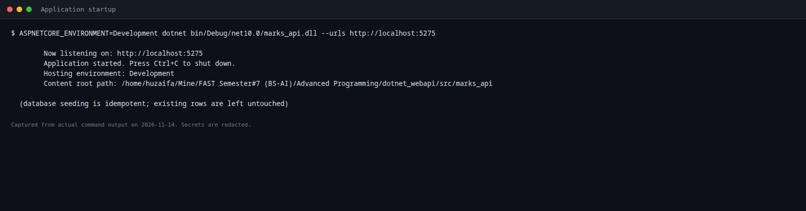

### Database tables and relationships

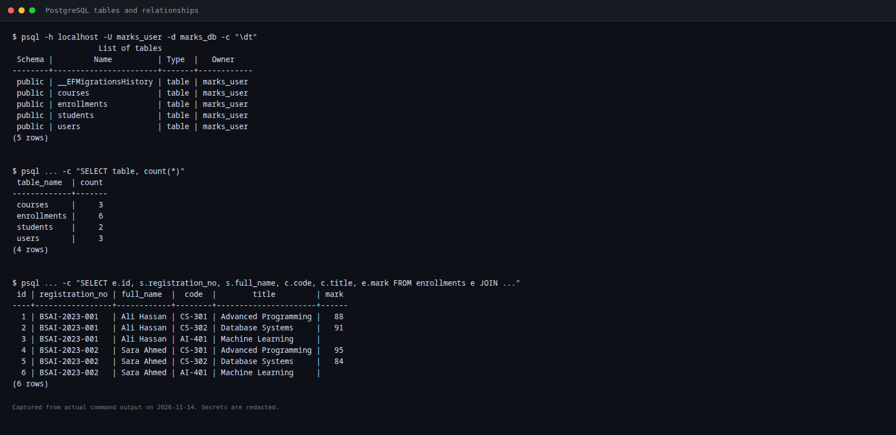

### Teacher and Student login

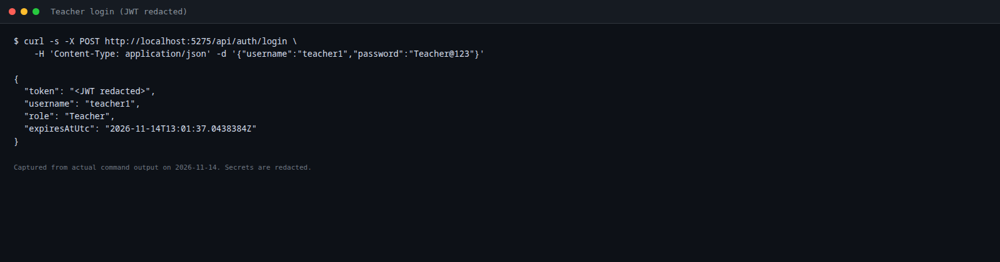

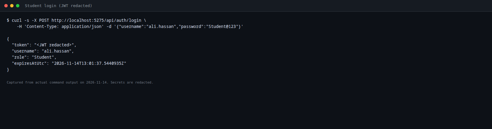

### Students CRUD

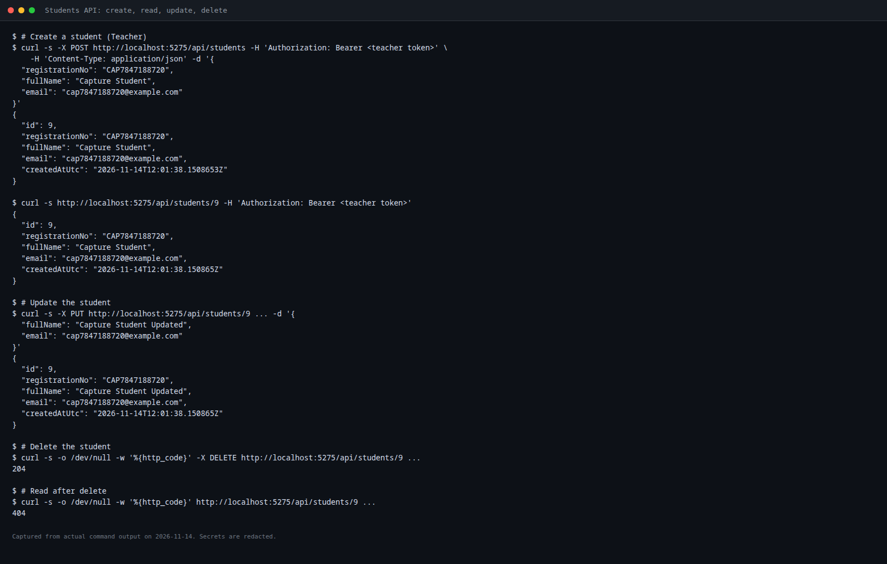

### Courses CRUD

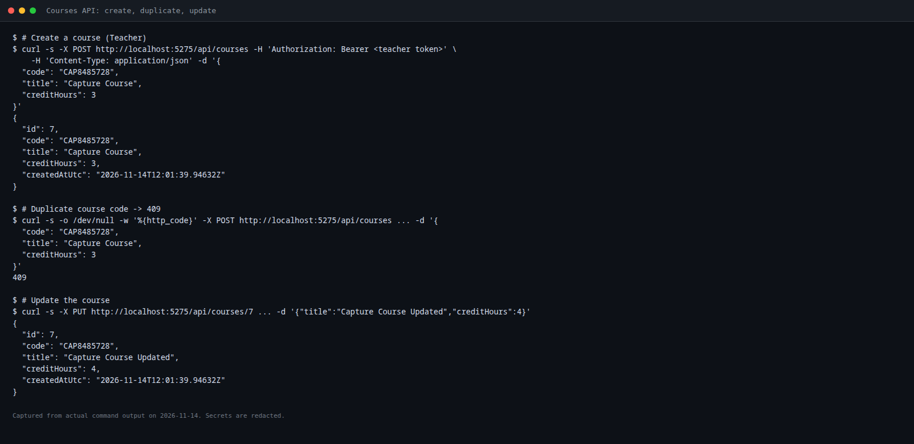

### Enrollments and marks

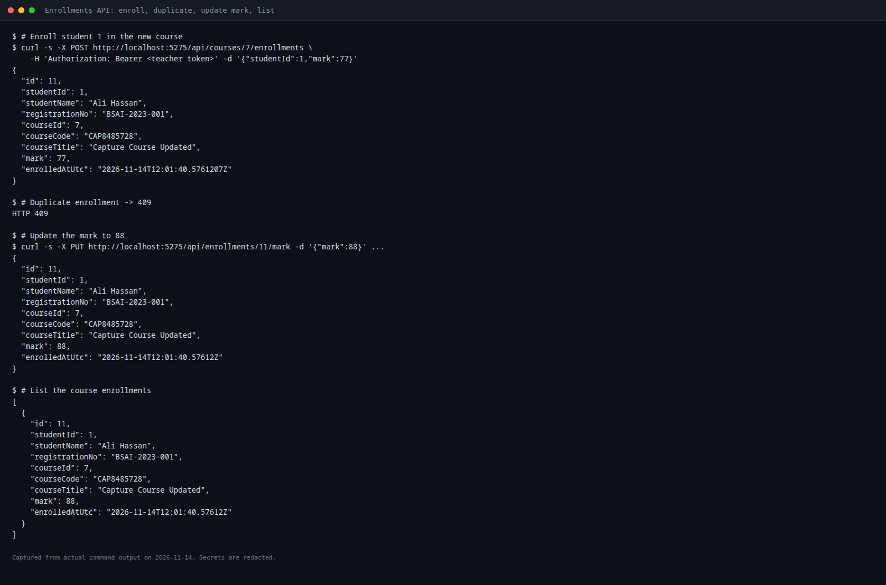

### Course statistics

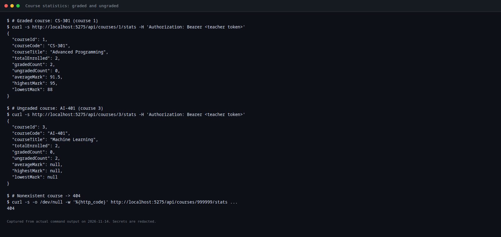

### Student transcript

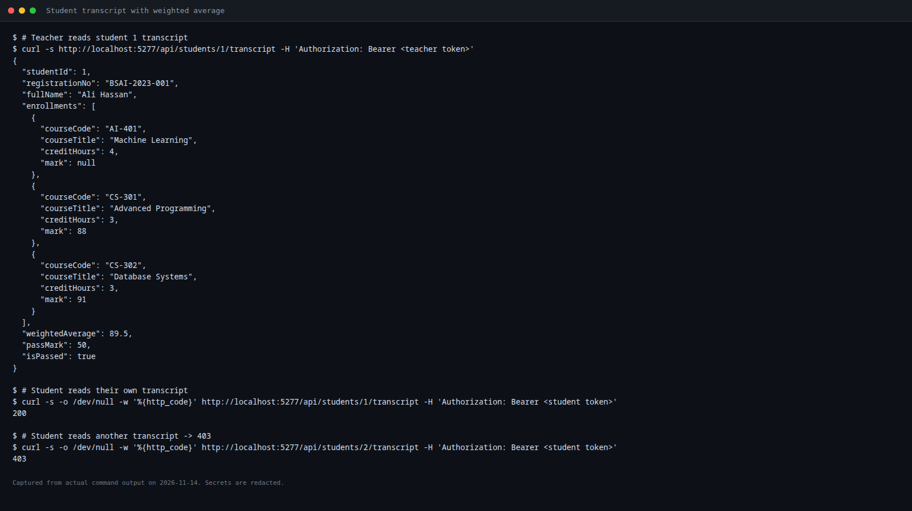

### 401, 403, and 400 responses

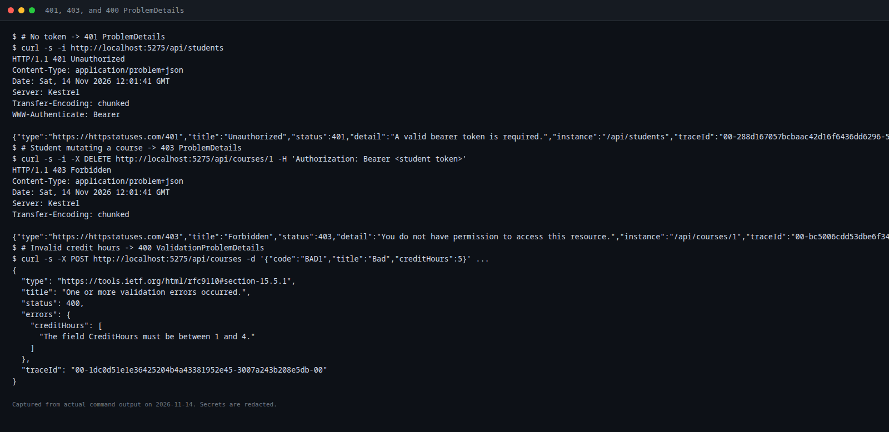

### Postman Collection Runner

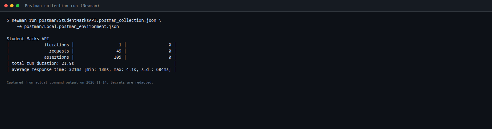

### Smoke tests

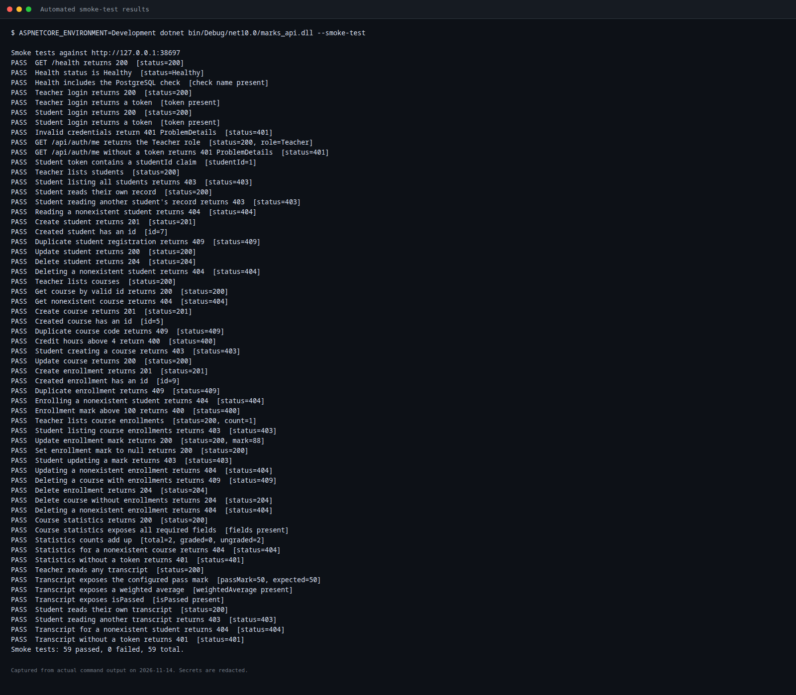

### Health check

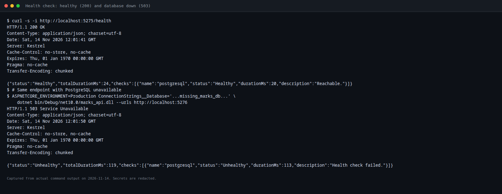

## Limitations

- Swagger/OpenAPI UI is not enabled; endpoint documentation is in this README and the Postman collection.
- The screenshots are terminal/API captures rendered to PNG, not DBeaver or browser GUI screenshots. No screenshot or result was fabricated.
- There is no refresh-token flow; access tokens expire after 60 minutes by default.
- CORS allows only the origins listed in `appsettings.json`. Add your frontend origin explicitly.
- The health check verifies that EF Core can open a PostgreSQL connection. It does not run a custom application query.
- Smoke tests require an existing migrated database with the Development seed data; they do not create the schema.
- The Postman environment contains the documented local demo credentials. Use a separate environment or secret store for any non-local deployment.
- The repository has not been committed or pushed; Git operations are intentionally left to the project owner.

## Project layout

```text
.
├── README.md
├── REPORT.md
├── appsettings.Example.json
├── db/
│   └── schema.sql
├── docs/
│   └── screenshots/
├── postman/
│   ├── StudentMarksAPI.postman_collection.json
│   └── Local.postman_environment.json
└── src/
    └── marks_api/
        ├── Common/
        ├── Data/
        ├── Dtos/
        ├── Endpoints/
        ├── Extensions/
        ├── Migrations/
        ├── Services/
        ├── SmokeTests/
        ├── Program.cs
        ├── appsettings.json
        └── marks_api.csproj
```
