# Student Marks Management API — Project Report

**Course project:** Advanced Programming  
**Stack:** C#, ASP.NET Core 10, EF Core 10, PostgreSQL 18, JWT  

## 1. Introduction and objectives

The Student Marks Management API is a layered web service for managing students, courses, enrollments, marks, course statistics, and student transcripts. The project began as a CRUD API and was completed in Phase 8 with analytics, weighted transcript calculations, consistent error handling, health monitoring, security hardening, automated verification, and documentation.

The Phase 8 objectives were:

1. Add course statistics with correct handling of ungraded enrollments.
2. Add credit-hour weighted transcript averages with a configurable pass mark.
3. Standardize all error responses as `ProblemDetails` and handle unhandled exceptions globally.
4. Add a health endpoint that reports PostgreSQL connectivity.
5. Audit authentication, authorization, validation, logging, and database constraints.
6. Deliver a runnable Postman collection, a smoke-test mode, a schema export, and complete documentation with genuine evidence.
7. Preserve the existing architecture, naming, and working behavior.

All functional objectives were implemented and verified against a real PostgreSQL database. This report describes the final system and the actual test results.

## 2. Technologies used

| Technology | Role |
|---|---|
| .NET 10 / C# | Runtime and language |
| ASP.NET Core minimal APIs | HTTP endpoints and middleware |
| EF Core 10 | ORM, migrations, query projection |
| `EFCore.NamingConventions` | Snake_case table and column names |
| PostgreSQL 18 | Relational database |
| JWT Bearer authentication | Stateless authentication |
| `PasswordHasher<User>` | Password hashing |
| EF Core health checks | PostgreSQL connectivity check |
| `ILogger<T>` | Structured application logging |
| Postman 11 / Newman 6.2.3 | Collection Runner and CI-friendly API tests |
| `pg_dump` 18.6 | Schema-only SQL export |
| Chromium headless | Rendering genuine terminal captures to PNG |

The API uses only the packages already present in the project: `Npgsql.EntityFrameworkCore.PostgreSQL`, `Microsoft.AspNetCore.Authentication.JwtBearer`, `Microsoft.EntityFrameworkCore.Design`, and `Microsoft.Extensions.Diagnostics.HealthChecks.EntityFrameworkCore`.

## 3. System architecture

The project keeps the original four-layer flow:

```text
Endpoints
   |
   v
Service interfaces
   |
   v
Service implementations
   |
   v
AppDbContext
   |
   v
PostgreSQL
```

- **Endpoints** validate request DTOs, enforce route-level authorization, and translate `ServiceResult` values into HTTP responses.
- **Interfaces** define asynchronous operations with `CancellationToken` parameters.
- **Implementations** contain business rules, EF Core queries, logging, and duplicate handling.
- **AppDbContext** maps entities to PostgreSQL using explicit configurations and snake_case naming.
- **DTOs** are used for all request and response bodies; EF entities are never exposed directly.

`Program.cs` is the composition root. It registers the DbContext, services, JWT authentication, authorization, ProblemDetails, CORS, health checks, and the global exception handler. Authentication middleware runs before authorization. The Development environment seeds demo data only when the tables are empty.

A dedicated `SmokeTests/` folder contains `SmokeTestRunner`, `SmokeTestClient`, `SmokeTestData`, and `SmokeTestResults`. The runner is started only by an explicit `--smoke-test` argument, `SMOKE_TEST=true`, or `SmokeTest:Enabled`; it is never part of a normal application start.

## 4. Database design and relationships

The migrated schema has four application tables plus EF Core's `__EFMigrationsHistory`:

| Table | Important columns | Constraints |
|---|---|---|
| `students` | `id`, `registration_no`, `full_name`, `email`, `created_at_utc` | PK; unique registration number; unique email; lowercase-email check |
| `courses` | `id`, `code`, `title`, `credit_hours`, `created_at_utc` | PK; unique code; `credit_hours` between 1 and 4 |
| `enrollments` | `id`, `student_id`, `course_id`, `mark`, `enrolled_at_utc` | PK; two FKs with `ON DELETE RESTRICT`; unique `(student_id, course_id)`; mark is null or 0–100 |
| `users` | `id`, `username`, `password_hash`, `role`, `student_id` | PK; unique username; FK to students; role is `Teacher` or `Student` |

A student has many enrollments; a course has many enrollments. Each enrollment connects exactly one student and one course. The composite unique index on `(student_id, course_id)` prevents duplicate enrollment even when two concurrent requests pass the application-level existence check. The foreign keys use `ON DELETE RESTRICT`, so deleting a student or course with enrollments is rejected by both the service logic and the database.

`db/schema.sql` was regenerated with:

```bash
pg_dump -h localhost -p 5432 -U marks_user -d marks_db \
  --schema-only --no-owner --no-privileges > db/schema.sql
```

The exported file includes all four application tables, primary keys, three foreign keys, four check constraints, and seven indexes (including five unique indexes). It was applied successfully to a throwaway schema to prove that the DDL is valid. EF Core migrations remain the source of truth; the export does not replace them. As requested, no ERD is included in this report.

## 5. API implementation and business rules

### Authentication and identity

`POST /api/auth/login` verifies the username and password, then returns a JWT containing `sub`, `unique_name`, `role`, `jti`, and, for students, `studentId`. `GET /api/auth/me` returns the current token's identity. Login is anonymous; every other API route except `/health` requires authentication.

### Students

Students support paged listing, case-insensitive search over name/email/registration number, and whitelisted sorting. Unsupported sort fields and invalid page sizes return 400. Search terms escape `%`, `_`, and `\`, so user input is matched literally. A student may read only their own record and transcript; a Teacher may read any student. Create and update handle PostgreSQL `23505` unique violations as 409 Conflict, including concurrent requests.

### Courses

Course codes are trimmed and normalized to uppercase. Duplicate codes return 409, invalid credit hours return 400, and code is immutable after creation. Deleting a course with enrollments returns 409. Read-only course access is available to both roles; mutations are Teacher-only.

### Course statistics

`GET /api/courses/{courseId}/stats` returns the course identity, total enrolled, graded and ungraded counts, and average/highest/lowest marks. Only non-null marks contribute to the statistics. If no student has been graded, the three statistical fields are `null` rather than zero. A missing course returns 404 ProblemDetails.

For example, CS-301 has two graded students (88 and 95): total 2, graded 2, ungraded 0, average 91.5, highest 95, lowest 88. AI-401 has two ungraded students: total 2, graded 0, ungraded 2, and all statistical values `null`.

### Enrollments

Enrollment creation checks that the course and student exist, validates an optional mark (0–100), and rejects duplicates. The response includes student name, registration number, course code, title, mark, and timestamp. Marks can be updated to a value or cleared to `null`. Only Teachers may create enrollments, list a course's enrollments, update marks, or delete enrollments. Students receive 403 on those routes.

### Transcripts

`GET /api/students/{id}/transcript` returns student information, all enrolled courses (including ungraded ones), the configured pass mark, a credit-hour weighted average, and `isPassed`. Ungraded courses remain visible but are excluded from the average. If no course is graded, `weightedAverage` and `isPassed` are `null`. The pass mark is read from `TranscriptSettings:PassMark` (default 50); it is not hard-coded in the transcript logic.

Ali Hassan's transcript is `(88×3 + 91×3) / 6 = 89.5`, with AI-401 excluded because its mark is null.

## 6. Authentication and security

- **JWT validation:** signature, issuer, audience, lifetime, and signing key are all validated; `ClockSkew` is zero.
- **Roles:** Teacher/Student role claims are enforced through endpoint authorization policies.
- **Ownership:** `CanAccessStudent` restricts students to their own student ID and transcript; Teachers bypass the restriction.
- **Passwords:** hashed with `PasswordHasher<User>`; plaintext passwords are never stored or logged.
- **Secrets:** the database connection string, JWT signing key, and smoke-test passwords live in User Secrets, not source control. `appsettings.json` contains no secret; production must supply values through environment variables or a secret store.
- **HTTPS and CORS:** HTTPS redirection is enabled. CORS uses an explicit allow-list from `Cors:AllowedOrigins`; wildcard origins are not used.
- **Errors:** all expected failures return `application/problem+json` with a status, title, detail, instance, and trace ID. The global handler logs exceptions server-side and returns a generic message, so stack traces, SQL, and database details are not exposed.
- **Logging:** important operations (login success/failure, creates, updates, deletes) are logged. Passwords, hashes, JWTs, and connection strings are never logged.
- **Data access:** read queries use `AsNoTracking()` and DTO projection. All database operations are asynchronous and accept `CancellationToken`.
- **Validation:** Data Annotations and service-level checks cover required fields, string lengths, email format, credit hours, marks, pagination, and sorting.
- **Database integrity:** unique indexes, check constraints, and restrictive foreign keys back up the application rules.
- **Concurrency:** duplicate student, course, and enrollment inserts catch PostgreSQL `23505` and return 409 instead of 500.
- **Timestamps:** `DateTime.UtcNow` is used for all created/enrolled timestamps, stored as `timestamp with time zone`.

A minor leftover is an unused historical `Jwt:Key` User Secret. It is not read by the application and is not present in source control; it can be removed with `dotnet user-secrets remove "Jwt:Key"`.

## 7. Testing methodology and actual results

Testing used a real PostgreSQL database, a real Kestrel process, and real HTTP requests. No mocks or fabricated results were used.

### Build and migration checks

| Check | Command | Result |
|---|---|---|
| Restore/build | `dotnet build` | 0 warnings, 0 errors |
| Migration list | `dotnet ef migrations list` | `20261109132945_InitialCreate` |
| Migration apply | `dotnet ef database update` | No migrations applied; database already up to date |
| Schema export | `pg_dump --schema-only` | 4 application tables, 5 PKs, 3 FKs, 4 checks, 7 indexes |
| Schema replay | Apply export to a throwaway schema | Completed with exit code 0 |
| Fresh setup | New empty PostgreSQL cluster → `dotnet ef database update` → Development seed → smoke suite | 59 passed, 0 failed; seeded 2/3/6/3 |

### API regression and Phase 8 checks

A 60-assertion shell test covered statistics, transcript math, pass-mark configuration, ProblemDetails, health, JWT challenge/forbid, validation, and regression of students/courses/enrollments. Result: **60 passed, 0 failed**.

Key verified values:

- CS-301 statistics: total 2, graded 2, ungraded 0, average 91.5, high 95, low 88.
- AI-401 statistics: total 2, graded 0, ungraded 2, all statistical fields `null`.
- Transcript for student 1: weighted average 89.5, pass mark 50, `isPassed=true`.
- Student 1 reading student 2's transcript: 403 ProblemDetails.
- No token on a protected route: 401 ProblemDetails with `WWW-Authenticate: Bearer`.
- Nonexistent course: 404 ProblemDetails.
- Invalid credit hours: 400 ValidationProblemDetails.
- `/health`: 200 `Healthy`; with PostgreSQL unavailable: 503 `Unhealthy`, without connection details.
- Forced database exception: a NUL byte in a student registration value produced a real PostgreSQL `22021` error. The API returned `500 application/problem+json` with `"An unexpected error occurred while processing the request."`; the Npgsql exception and stack trace appeared only in the server log, not in the response.

### Postman / Newman

The collection contains **49 requests** across seven folders and **105 assertions**, including more than 20 negative tests. The login requests save the JWT automatically, and the collection uses bearer authentication at the collection level. Temporary IDs are saved to the environment and the test data is deleted at the end.

```bash
newman run postman/StudentMarksAPI.postman_collection.json \
  -e postman/Local.postman_environment.json
```

Actual result: **49 requests executed, 0 failed; 105 assertions, 0 failed; run time 21.9 s; exit code 0.** The database was back to 2 students, 3 courses, and 6 enrollments afterward.

### Smoke tests

```bash
ASPNETCORE_ENVIRONMENT=Development \
  dotnet run --no-launch-profile -- --smoke-test
```

The runner starts Kestrel on a random loopback port, obtains credentials from User Secrets, exercises all endpoint groups (success and failure), and cleans up created records in a `finally` block. Actual result: **59 passed, 0 failed, exit code 0**.

The smoke-test summary reported `Statistics counts add up [total=2, graded=0, ungraded=2]` because the first course alphabetically was AI-401, which also confirms the all-ungraded `null` behavior. The transcript checks confirmed `passMark=50`.

A separate fresh-setup check started an empty throwaway PostgreSQL cluster, created the role and database, applied the EF migration, let Development seed the data, and ran the same smoke suite. It also passed **59/59** and left the new database with 2 students, 3 courses, 6 enrollments, and 3 users.

### Seed state after testing

`students=2`, `courses=3`, `enrollments=6`, `users=3`. The seeded relationship query returned the expected six enrollment rows with correct student, course, and mark data.

## 8. Screenshots

The screenshots below are genuine captures of the running application, `psql`, `curl`, Newman, and the smoke-test runner. They were rendered to PNG from the actual terminal output because a DBeaver GUI is not available in this environment. JWT values are redacted; no screenshot or result was fabricated.

### Application startup

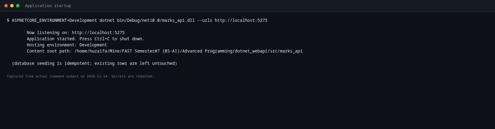

### Database tables and relationships

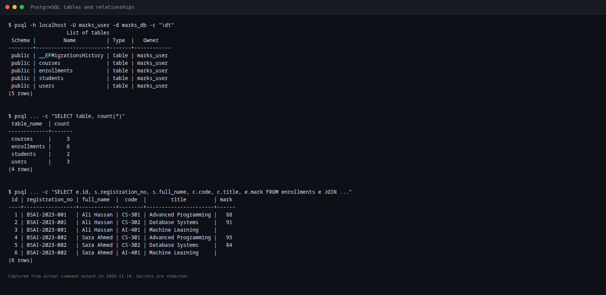

### Teacher and Student login

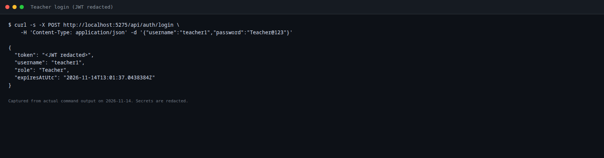

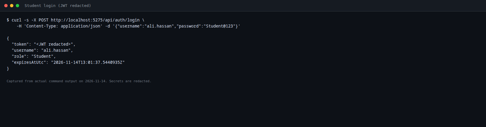

### Students CRUD

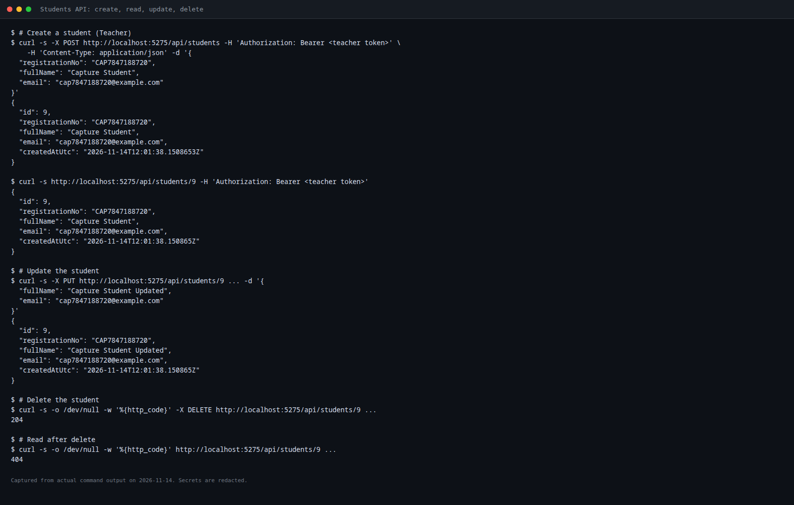

### Courses CRUD

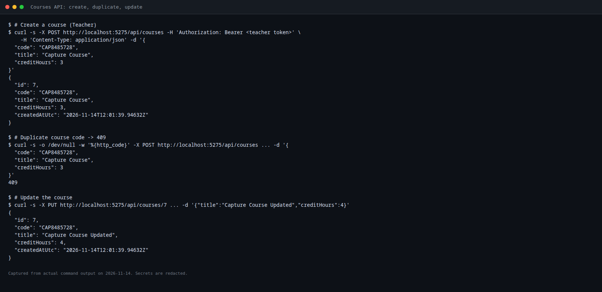

### Enrollment creation and mark update

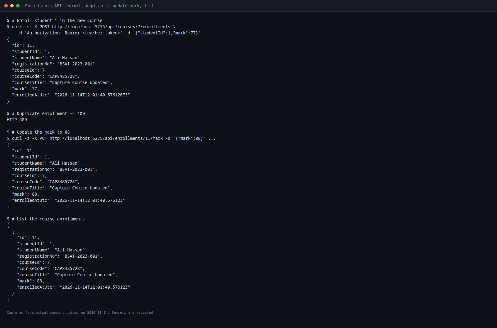

### Course statistics

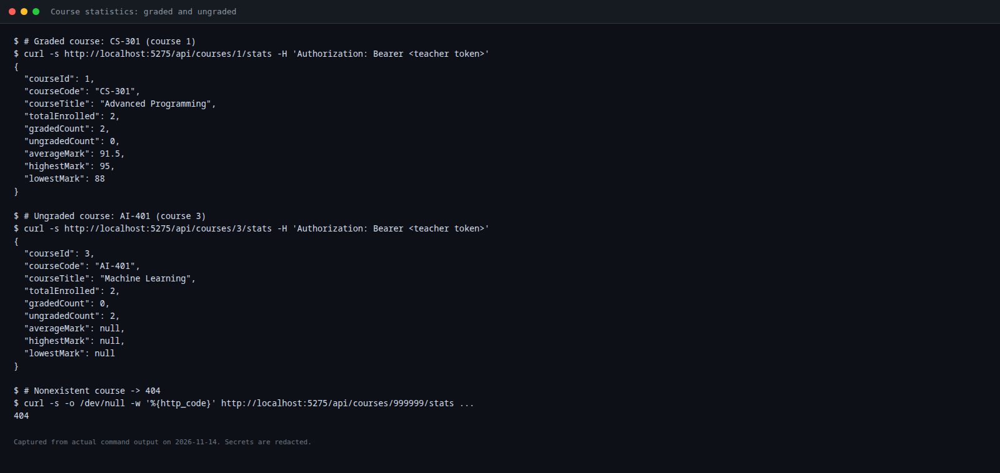

### Student transcript

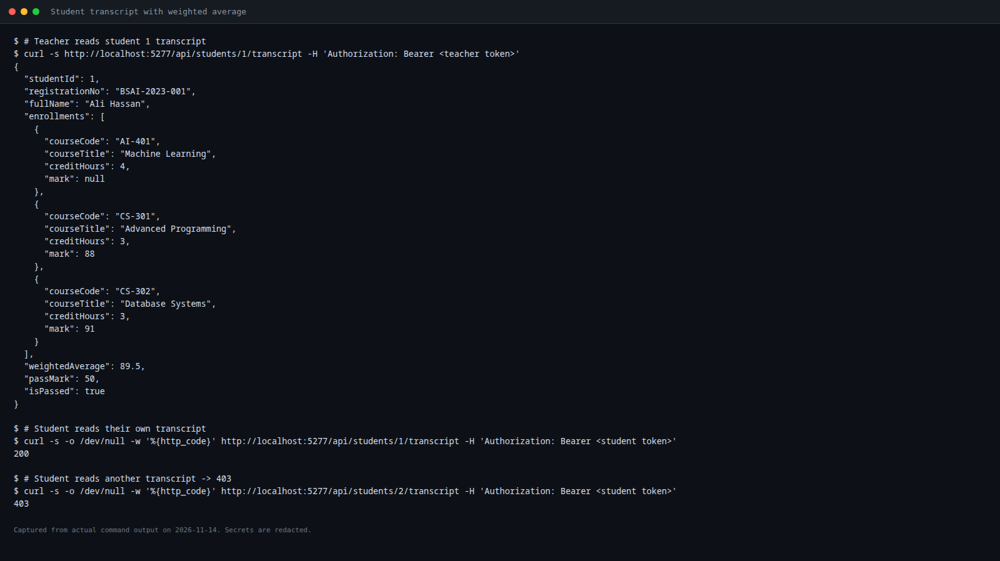

### Unauthorized and forbidden responses

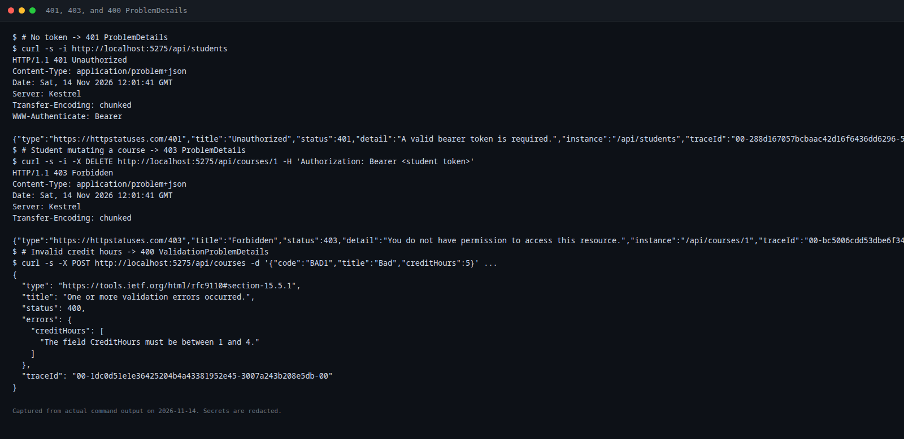

### Postman Collection Runner

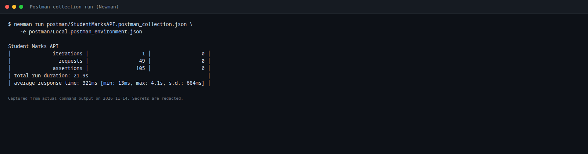

### Smoke-test output

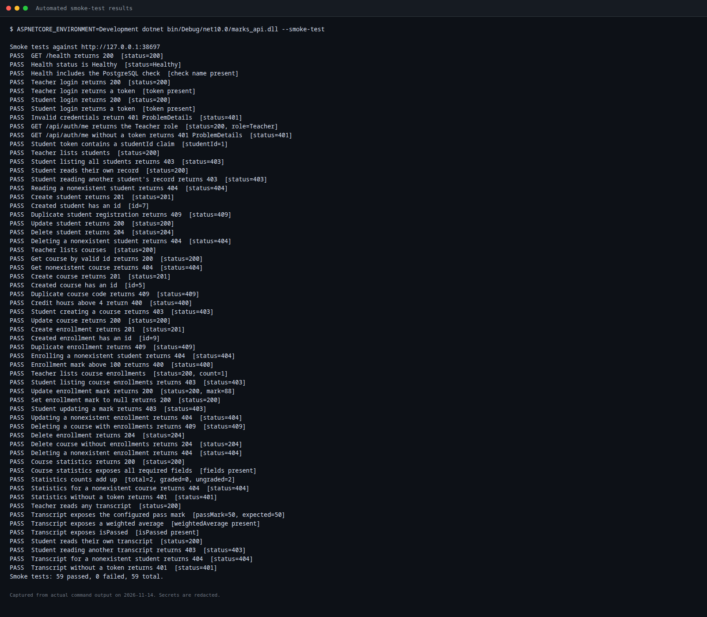

### Health endpoint (healthy and database unavailable)

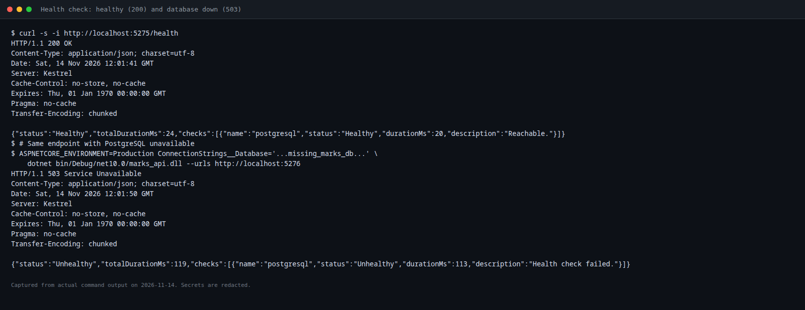

## 9. Challenges and resolutions

1. **Correct statistics with nullable marks.** A simple average would fail or produce misleading zeros when every mark was null. The implementation splits marks into graded and ungraded sets after an `AsNoTracking` projection and returns explicit `null` statistical values when nothing is graded.
2. **Weighted average with ungraded courses.** The transcript must list all enrollments but exclude ungraded ones from the denominator. Filtering by `Mark.HasValue` and summing `mark × creditHours` over the remaining rows produced the expected 89.5 for student 1.
3. **Consistent ProblemDetails content type.** `WriteAsJsonAsync` changed the content type to `application/json`. Writing the responses through `Results.Problem(...).ExecuteAsync(...)` preserved `application/problem+json` for JWT challenges, forbidden responses, status-code pages, and global exceptions.
4. **Smoke tests without a fixed port.** Starting Kestrel on `http://127.0.0.1:0` and reading the actual address from `IServerAddressesFeature` allows repeatable runs without port conflicts.
5. **Postman URL construction.** An initial collection duplicated `baseUrl` because the parsed URL path still contained it. Stripping the base prefix from the path fixed all requests; the final run completed with 105 passing assertions.
6. **Concurrent uniqueness.** Application-level checks alone cannot prevent two simultaneous inserts. Catching PostgreSQL `23505` for students, courses, and enrollments turns the race into a correct 409 response.
7. **No GUI database tool for screenshots.** DBeaver and a GUI browser session were unavailable. Genuine terminal/API output was captured and rendered to PNG with Chromium; the report labels these honestly rather than fabricating GUI screenshots.
8. **Tool availability.** Newman and `dotnet-ef` were installed locally/globally for verification; the application itself does not depend on them at runtime.

## 10. Conclusion and future improvements

The Phase 8 requirements are implemented and verified. The API now provides course analytics, credit-weighted transcripts with a configurable pass mark, standardized errors, health monitoring, restricted CORS, hardened authentication/authorization, realistic database constraints, a runnable Postman collection, and an explicit smoke-test mode. All documented test runs completed without failures, and the database remained in its seeded state after testing.

Possible future improvements:

- Add Swagger/OpenAPI documentation and a small frontend.
- Add refresh tokens and token revocation.
- Add automated unit/integration tests to a CI pipeline.
- Add database-level tests for concurrent duplicate inserts.
- Add rate limiting for login and write endpoints.
- Expand health checks to include disk space and external dependencies.
- Add role-specific audit logging without sensitive data.
- Add pagination to course and enrollment lists if data volume grows.
